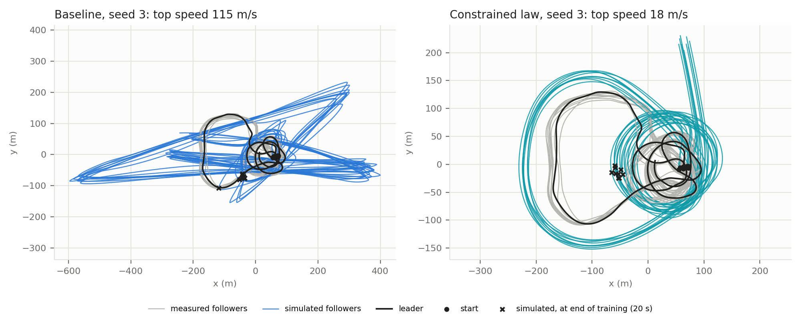
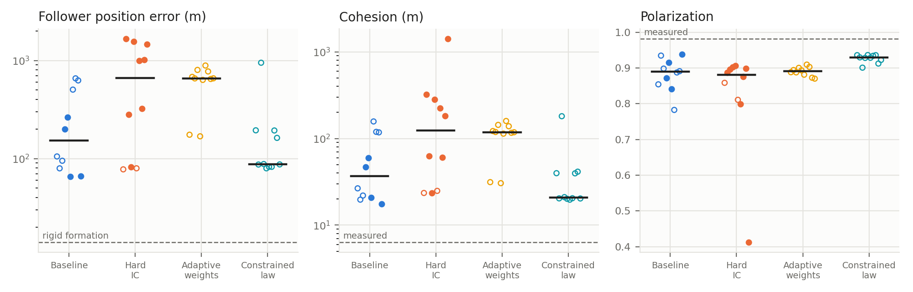

# Stabilising a PINN for pigeon-flock interaction laws

CEE 292 course project. It reproduces the physics-informed neural network (PINN) of Kim et al. (2025),
*Commanding Emergent Behavior with Neural Networks*
([original code](https://github.com/dongjokim03/Collective_motions_training)). That network infers a pairwise interaction law from the GPS tracks of a ten-pigeon flock (Nagy et al. 2010).

The project then tests three changes, judged by how well the learned law works as a **forward model**, i.e. by simulating the flock for 140 s:
- a hard initial condition;
- self-adaptive loss weights;
- constraints on the learned force law.

The full write-up is in [`report/report.pdf`](report/report.pdf).

## Results (10 seeds per method, simulation over the unseen 20–140 s)

| | Baseline | Hard IC | Adaptive weights | Constrained law |
|---|---|---|---|---|
| Training successes | 4/10 | **8/10** | 0/10 | 0/10 |
| Median final training loss | 8.82 | **5.34** | 73.1 | 8.48 |
| Follower position error, median / best (m) | 153 / **65** | 660 / 78 | 657 / 169 | **88** / 80 |
| Mann–Whitney *p* against baseline | – | 0.10 | 0.006 | 0.62 |
| Runs with error < 150 / 150–400 / > 400 m (break-away) | 5 / 2 / 3 | 3 / 2 / 5 | 0 / 2 / 8 | **6** / 3 / **1** |
| Blow-ups (follower faster than 50 m/s) | 2 | 8 | **0** | **0** |
| Median cohesion (m; measured 6.3) | 37 | 123 | 119 | **21** |
| Median polarization (measured 0.98) | 0.89 | 0.88 | 0.89 | **0.93** |

**Reference.** A rigid formation, where every follower keeps its starting offset from the leader, scores 14 m.

**What the methods do to the simulation:**
- **Hard IC** fits the training data best, but its laws blow up in simulation.
- **Adaptive weights** give up the trajectory fit, and the followers break away from the leader.
- **The constrained law** is the only method that improves the simulation. It combines:
  - a distance cap at 59 m;
  - an acceleration cap at 10 m/s²;
  - a minimum pull at 30–60 m;
  - each bird's own cruising speed.

  It removes the blow-ups and most break-aways. The gain is not statistically significant over 10 seeds.




## Repository layout

| Path | Contents |
|---|---|
| `training.ipynb` | Data, PINN, the four methods, the training loop, the check against the shipped results, and Figure 1 (loss curves) |
| `simulation.ipynb` | Forward simulation of every learned law, the metrics, Table 1, Figure 2 (flight paths) and Figure 3 (metrics) |
| `data/pigeon_flock_18980_to_19120.csv` | Flight of the 10 pigeons over 18980–19120 s, one row every 0.2 s (701 rows): time, then x, y, vx, vy of each bird A, B, C, D, G, H, I, J, L, M. Bird A is the leader. Training uses the first 101 rows (18980–19000 s). |
| `results/learned_coefficients.csv` | Our 40 trained runs (4 methods × seeds 0–9): success test, final losses, v0, and the 25 learned coefficients |
| `results/training_logs.csv` | Every optimisation step of those 40 runs |
| `figures/` | Figures written by the notebooks |
| `report/` | The report (LaTeX source and PDF) |

The method keys used in the notebooks and CSVs are:

| Key | Method |
|---|---|
| `full` | Baseline |
| `hic` | Hard IC |
| `aw2` | Adaptive weights |
| `pull_tail_v0` | Constrained law |

## How to reproduce

```bash
pip install -r requirements.txt
jupyter notebook          # then open the notebooks from this folder
```

1. **`simulation.ipynb`** runs the shipped coefficients of all 40 runs (about 5–10 min on a laptop CPU) and rebuilds Table 1 and Figures 2–3.
2. **`training.ipynb`** trains one demonstration run (the baseline, seed 3, about 5–10 min) and compares it with the shipped result. It also redraws Figure 1 from the shipped logs.
   - To retrain everything, set `VARIANTS_TO_TRAIN = ['full', 'hic', 'aw2', 'pull_tail_v0']` and `SEEDS = range(10)`. That takes about 5–10 h on one CPU core.
   - Then set `RESULTS_DIR = Path("outputs")` in `simulation.ipynb` to simulate your own runs.

**Bit-exact reproducibility.** Training runs on the CPU with one thread. With the pinned versions (Python 3.12, PyTorch 2.14.1), a run gives exactly the shipped coefficients and losses. Other versions or hardware give tiny rounding differences, which grow during L-BFGS, so individual runs can end differently. Medians over 10 seeds should be similar.

## Changes from the original code

The physics, loss, network, hyperparameters, early-stopping rule and success test are those of the original notebook. A few bugs were fixed:
- **Adam.** The original re-created the Adam optimiser at every step, which discarded its momentum. Here it is created once per run.
- **NaN guard.** The original tested `isfinite(loss).item` without the `()`, which is always true, so a NaN loss was never caught.
- **Success test.** It is applied at the final parameters, not at the last line-search point of L-BFGS.
- **Seeding.** PyTorch is seeded, so runs are repeatable.
- **Retries.** The original retries new random initialisations until one passes the success test. Here, each seed is one run.

**Simulation, compared with the original simulation notebook:**
- one common centre for all birds;
- the measured initial velocities;
- the same cruising speed v0 as in training;
- no random noise in the equations of motion.

## Data and references

- Data: M. Nagy, Z. Ákos, D. Biro and T. Vicsek, *Hierarchical group dynamics in pigeon flocks*, Nature 464, 890–893 (2010). The CSV joins the two files of the original repository (18980–19000 s and 19000–19120 s).
- D. Kim et al., *Commanding Emergent Behavior with Neural Networks* (2025), code: https://github.com/dongjokim03/Collective_motions_training.
